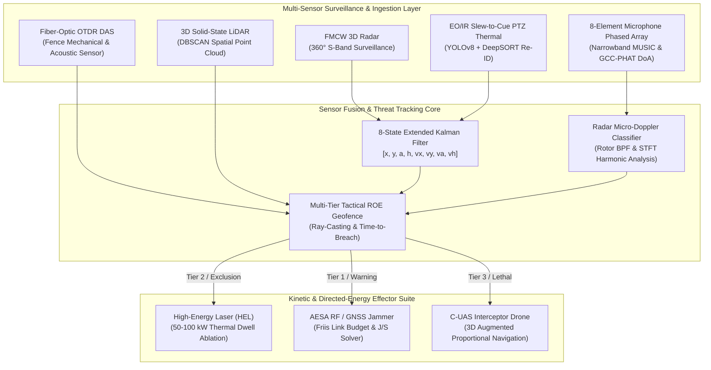

# IronPerimeter — Autonomous Military Base Defense & Counter-UAS AI Digital Twin

[](https://github.com/Tareq0001/IronPerimeter-Base-Defense-AI/actions/workflows/ci.yml)
[](https://tareq0001.github.io/IronPerimeter-Base-Defense-AI/)
[](https://www.typescriptlang.org/)
[](https://isocpp.org/)
[](https://python.org/)
[](https://tareq0001.github.io/IronPerimeter-Base-Defense-AI/)

> **IronPerimeter** is a multi-domain, autonomous Counter-Unmanned Aerial System (C-UAS) and critical military infrastructure perimeter defense digital twin. It integrates multi-sensor fusion (FMCW 3D Radar, Fiber-Optic Distributed Acoustic Sensing (DAS), 8-Element Microphone Phased Array MUSIC DoA, EO/IR YOLOv8 + DeepSORT tracking, and 3D LiDAR DBSCAN) with automated kinetic and directed-energy effectors (High-Energy Laser dwell, Multi-Band RF/GNSS jamming link budget, and 3D Augmented Proportional Navigation interceptor drones).

---

## 📐 System Architecture



---

## ⚡ Core Mathematical & Engineering Modules

### 1. YOLOv8 + DeepSORT Multi-Object Tracker (`src/vision/yolov8_deepsort_tracker.ts`)
- **Non-Maximum Suppression (NMS):** Vectorized bounding box intersection over union suppression with sorted confidence priority.
- **Cost Matrix & Association:** Dual-stage cascade matching incorporating both cosine appearance embedding distance and IoU bipartite assignment:
  $$\text{IoU}(A, B) = \frac{\text{Area}(A \cap B)}{\text{Area}(A \cup B)}$$
- **8-State Kalman Box Filter:** Continuous tracking state $\vec{x} = [x_c, y_c, a, h, v_{xc}, v_{yc}, v_a, v_h]^T$ maintaining track persistence across optical occlusions and thermal smoke decoys.

### 2. Acoustic Phased Array MUSIC Direction-of-Arrival (`src/cuas/acoustic_doa_array.ts`)
- **Speed of Sound Temperature Correction:**
  $$c(T) = 331.3 \sqrt{1 + \frac{T}{273.15}} \quad [\text{m/s}]$$
- **GCC-PHAT Time Difference of Arrival (TDoA):**
  $$R_{xy}^{\text{PHAT}}(\tau) = \mathcal{F}^{-1} \left( \frac{X(f) Y^*(f)}{|X(f) Y^*(f)|} \right)$$
- **MUSIC Spatial Pseudo-Spectrum:** Evaluates narrowband spatial covariance matrix $R_{xx} = \frac{1}{K} \sum_{k=1}^K X_k X_k^H$, projects against noise subspace eigenvectors $E_n$, and detects azimuth $\theta$ and elevation $\phi$:
  $$P_{\text{MUSIC}}(\theta, \phi) = \frac{1}{\vec{a}^H(\theta, \phi) E_n E_n^H \vec{a}(\theta, \phi)}$$

### 3. Kinetic & Electronic Warfare Effectors (`src/cuas/kinetic_ew_effector.ts`)
- **High-Energy Laser (HEL) Thermal Ablation:**
  - Diffraction + jitter spot size: $d_{\text{spot}} = \sqrt{d_{\text{diff}}^2 + d_{\text{jitter}}^2} = \sqrt{\left(2.44 \frac{\lambda R}{D} M^2\right)^2 + (2 R \theta_{\text{jitter}})^2}$
  - Beer-Lambert atmospheric attenuation: $P_{\text{target}} = P_0 e^{-\gamma R_{\text{km}}}$
  - Material dwell time: $t_{\text{dwell}} = \frac{F_{\text{kill}}}{I \cdot \eta_{\text{absorption}}}$ (calculates lethal burn time against CFRP drone fuselages, aluminum skins, and optical seekers).
- **RF Jammer Link Budget & Jam-to-Signal ($J/S$) Ratio:**
  - Evaluates Free Space Path Loss (FSPL) and antenna directivity over GNSS L1/L2 and ISM 2.4/5.8 GHz C2 bands:
    $$(J/S)_{\text{dB}} = P_{\text{jam}} + G_{\text{jam}} - \text{FSPL}_{\text{jam}} - L_{\text{pol}} - (P_{\text{gcs}} + G_{\text{gcs}} - \text{FSPL}_{\text{gcs}})$$
- **3D Augmented Proportional Navigation (APN) Guidance:**
  - Closed-loop interceptor acceleration command with airframe G-limiting:
    $$\vec{a}_{\text{cmd}} = N \cdot V_c \cdot (\vec{\Omega}_{\text{LOS}} \times \hat{v}_{\text{int}}) + \frac{1}{2} N \vec{a}_{\text{tgt},\perp}$$
  - Where Line-of-Sight rotation rate $\vec{\Omega}_{\text{LOS}} = \frac{\vec{R} \times \vec{V}_{\text{rel}}}{|\vec{R}|^2}$ and closing speed $V_c = -\frac{\vec{R} \cdot \vec{V}_{\text{rel}}}{|\vec{R}|}$.

### 4. Multi-Tier Tactical ROE Geofence & 3D LiDAR DBSCAN (`src/geofence/perimeter_zone_engine.ts`)
- **Concentric Military Geofence Tiers:**
  - **Tier 0 (HVA Sanctum):** Command Bunker & Ammo Depot (< 180m) — Zero-tolerance automated CIWS / HEL engagement.
  - **Tier 3 (Lethal Kill Zone):** Inner Base (< 500m) — Autonomous kinetic interceptor drone launch.
  - **Tier 2 (Exclusion Zone):** Intermediate Perimeter (500m - 1200m) — Multi-band AESA RF jamming.
  - **Tier 1 (Surveillance Perimeter):** Outer Buffer (1200m - 2500m) — S-Band FMCW radar & acoustic cueing.
- **3D LiDAR DBSCAN Point Cloud Segmentation:** Density-based clustering isolating micro-UAV centroids, calculating 3D oriented bounding boxes, and rejecting ground clutter.

---

## 🚀 C++17 Real-Time Inference Engine (`cpp_inference/`)

Engineered for embedded military mission computers (NVIDIA Jetson AGX Orin / TensorRT):
- `cpp_inference/tensorrt_cuas_detector.hpp`
- `cpp_inference/tensorrt_cuas_detector.cpp`
- Vectorized Non-Maximum Suppression (NMS), 3D Kalman target tracker, and high-speed 3D Proportional Navigation guidance solver.
- Fully standard C++17, zero external dependencies, compiled with `-O3 -Wall -Wextra`.

```bash
# Compile C++17 TensorRT inference module
g++ -std=c++17 -O3 -Wall -Wextra -c cpp_inference/tensorrt_cuas_detector.cpp -o tensorrt_cuas_detector.o
```

---

## 🧠 Python Radar Micro-Doppler Threat Classifier (`python_ai/`)

Physics-grounded radar return synthesis and spectral classification:
- `python_ai/cuas_threat_classifier.py`
- `python_ai/requirements.txt`
- Extracts Short-Time Fourier Transform (STFT) spectrograms, blade pass frequencies (BPF), spectral centroids, and harmonic-to-noise ratios (HNR).
- Classifies 5 operational categories: `UAV_QUADCOPTER`, `UAV_HEXA_OCTOCOPTER`, `LOITERING_MUNITION`, `FPV_RACING_STRIKE`, and `AVIAN_BIRD_DECOY`.

```bash
# Run standalone mathematical verification self-test
python python_ai/cuas_threat_classifier.py --self-test
```

---

## 🧪 Verification & Test Suite

The repository includes a comprehensive unit test suite in `tests/cuas_defense.test.ts` powered by Vitest:

| Test Module | Coverage Scope | Status |
| :--- | :--- | :---: |
| **YOLOv8 + DeepSORT** | IoU boundary math, NMS suppression, Kalman prediction & update, multi-frame track state machine | ✅ PASS |
| **Acoustic Array** | Temperature speed of sound, GCC-PHAT zero-delay lag, MUSIC pseudo-spectrum steering | ✅ PASS |
| **Kinetic & EW Effectors** | HEL laser dwell & irradiance, RF jammer link budget & $J/S$, 3D ProNav guidance law | ✅ PASS |
| **Geofence & DBSCAN** | Ray-casting point-in-polygon, concentric ROE tiers, 3D LiDAR point clustering | ✅ PASS |
| **Micro-Doppler AI** | Radar I/Q STFT spectrogram feature extraction & Gaussian MAP classification | ✅ PASS |

---

## 💻 Local Development & Build

```bash
# 1. Clone repository
git clone https://github.com/Tareq0001/IronPerimeter-Base-Defense-AI.git
cd IronPerimeter-Base-Defense-AI

# 2. Run TypeScript check (optional if dependencies installed)
npm run typecheck

# 3. Execute unit test suite
npm test

# 4. Launch Vite digital twin dev server
npm run dev
```

---

## 🌐 Live Production Deployment

- **Hosted URL:** [https://tareq0001.github.io/IronPerimeter-Base-Defense-AI/](https://tareq0001.github.io/IronPerimeter-Base-Defense-AI/)
- **Author & Architect:** Eng. Tareq Aboushi ([@Tareq0001](https://github.com/Tareq0001))
- **License:** MIT
